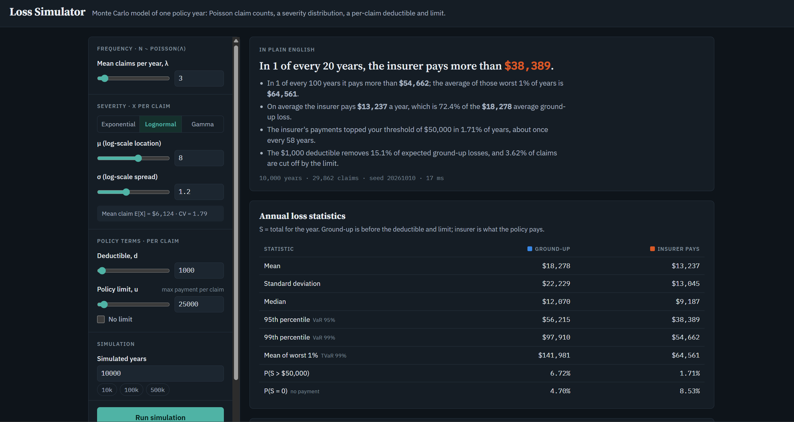

# Loss Simulator

**[▶ Try it live](https://github.com/3htan/loss-simulator)**: runs in your browser, nothing to install.

A Monte Carlo model of one year of insurance losses. Pick a claim frequency, a claim-size distribution and the policy terms (deductible and limit), and it simulates tens of thousands of years to show what the insurer should expect to pay on average, in a bad year, and in a 1-in-100 year.



## What it does

- **Frequency:** number of claims per year $N \sim \text{Poisson}(\lambda)$.
- **Severity:** each claim size $X$ is exponential, lognormal or gamma.
- **Policy terms:** a per-claim deductible $d$ and a per-claim limit $u$ on the payment.
- **Output:** mean, standard deviation, median, VaR and TVaR of the yearly total, both before policy terms (ground-up) and after (what the insurer pays), plus a histogram, the loss elimination ratio, and a plain-English summary.
- **Built-in check:** a "Simulation vs. theory" table compares the simulated mean and standard deviation against the exact formulas below, so you can see when the sample is large enough.
- **Reproducible:** every run uses a random seed. The same seed and inputs give the same result.

## The math

### Aggregate loss is a compound Poisson sum

$$S = X_1 + X_2 + \cdots + X_N, \qquad S = 0 \text{ if } N = 0$$

with $N$ and the $X_i$ independent. Conditioning on $N$ gives

$$\mathrm{E}[S] = \mathrm{E}[N]\,\mathrm{E}[X], \qquad \mathrm{Var}(S) = \mathrm{E}[N]\,\mathrm{Var}(X) + \mathrm{Var}(N)\,\mathrm{E}[X]^2$$

and because $\mathrm{E}[N] = \mathrm{Var}(N) = \lambda$ for a Poisson count, these simplify to

$$\mathrm{E}[S] = \lambda\,\mathrm{E}[X], \qquad \mathrm{Var}(S) = \lambda\,\mathrm{E}[X^2].$$

$S$ also has a point mass at zero: $P(S = 0) = P(N = 0) = e^{-\lambda}$.

### Severity moments used in the theory check

| Distribution | $\mathrm{E}[X]$ | $\mathrm{E}[X^2]$ |
|---|---|---|
| Exponential, mean $\theta$ | $\theta$ | $2\theta^2$ |
| Lognormal $(\mu, \sigma)$ | $e^{\mu + \sigma^2/2}$ | $e^{2\mu + 2\sigma^2}$ |
| Gamma $(\alpha, \theta)$ | $\alpha\theta$ | $\alpha(\alpha+1)\theta^2$ |

### Coverage modifications

With an ordinary deductible $d$ and a limit $u$ on the payment, the insurer pays per claim

$$Y = \min\big(\max(X - d,\, 0),\; u\big).$$

A claim is capped when $X \ge d + u$. The loss elimination ratio is the share of expected ground-up loss removed by the deductible:

$$\mathrm{LER} = \frac{\mathrm{E}[X \wedge d]}{\mathrm{E}[X]}.$$

> **Convention note.** Here $u$ is the *maximum payment*. Some texts (for example *Loss Models*, used for SOA FAM and CAS MAS-I) define $u$ as the *maximum covered loss*, so the most the insurer pays is $u - d$. To match that convention, enter $u - d$ as the limit.

### Risk measures

- $\mathrm{VaR}_p$ is the $p$-th percentile of $S$: the loss exceeded in a share $1 - p$ of years. $\mathrm{VaR}_{95\%}$ is the "1-in-20-year" loss.
- $\mathrm{TVaR}_{99\%}$ is the average of the worst 1% of simulated years.

Percentiles of a compound distribution have no simple closed form, which is why simulation (or Panjer recursion, or a normal approximation) is used to estimate them.

## How it's built

A single self-contained `index.html` with plain JavaScript and no framework or build step.

| Piece | Method |
|---|---|
| Random numbers | Mulberry32 seeded generator |
| Poisson counts | Knuth's multiplication method for $\lambda < 30$; Hörmann's PTRS transformed rejection for $\lambda \ge 30$ |
| Normal / lognormal | Box–Muller transform |
| Gamma | Marsaglia–Tsang, with the $U^{1/\alpha}$ boost for $\alpha < 1$ |
| Chart | Hand-drawn SVG histogram |

## Testing

`tests/check.js` pulls the simulation engine out of `index.html` and checks it against closed-form answers: the Poisson sampler on both sides of the algorithm switch, and for exponential claims with a deductible and limit, $\mathrm{E}[S]$, $\mathrm{SD}(S)$, $P(S=0)$, the LER, the insurer's expected payment $\lambda\theta\big(e^{-d/\theta} - e^{-(d+u)/\theta}\big)$ and the share of claims hitting the limit. Gamma and lognormal moments are checked too.

```bash
node tests/check.js
```

All checks agree with theory to within about 1%.

## How to run it

- **Online:** open the [live page](https://3htan.github.io/loss-simulator/).
- **Locally:** download `index.html` and open it in any modern browser. An internet connection is only needed for the web fonts.

## Exam connection

Frequency and severity models, coverage modifications, LER and aggregate loss models are core material for SOA Exam FAM and ASTAM and CAS Exam MAS-I.

## About

Built by Ethan Zuniga, applied mathematics student (Pierce College → CSUN), as a portfolio project while preparing for actuarial exams. Developed with AI assistance as part of coursework for the Google AI Professional Certificate. I specified the model, reviewed the math and validated the results.

[LinkedIn](www.linkedin.com/in/ethan-zuniga-476017326) · MIT License
